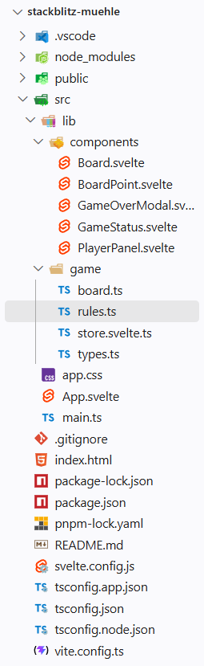

# Hechelbacher-Mitschrift

Mitschrift für den Unterricht von Markus Seiwald und Lucas Hechelbacher.

Diese Datei ist im Markdown-Format geschrieben. Markdown ist eine weit verbreitete Auszeichnungssprache ([Wikipedia](https://de.wikipedia.org/wiki/Auszeichnungssprache)).

## Inhaltsverzeichnis

- [Allgemeines](#allgemeines)
- [Webentwicklung: Grundlagen](#webentwicklung-grundlagen)
- [Installation und Werkzeuge](#installation-und-werkzeuge)
- [Vibe Coding und MCP](#vibe-coding-und-mcp)
- [Historische Entwicklung des Webs](#historische-entwicklung-des-webs)
- [Frontend-Entwicklung](#frontend-entwicklung)

## Allgemeines

### Webentwicklung: Grundlagen

#### Technologien einer Website

Eine Website wird typischerweise mit **HTML**, **CSS** und **JavaScript** erstellt:

- **HTML** bildet die grundlegende Struktur und den Inhalt einer Webseite.
- **CSS** gestaltet das Aussehen der Webseite.
- **JavaScript** ergänzt Interaktivität und Verhalten.

Das **DOM** (_Document Object Model_) ist eine Programmierschnittstelle für HTML- und XML-Dokumente. Es stellt ein Dokument als Baum von Objekten dar. Dadurch können Programmiersprachen wie JavaScript auf die Elemente zugreifen und sie verändern.

### UI-Komponenten

Eine UI-Komponente besteht im Allgemeinen aus drei Teilen:

- **Daten**: Zustand und Werte der Komponente
- **Template**: Vorlage für Struktur und Darstellung
- **Logik**: Funktionen und Verhalten der Komponente

### Zuweisung und Mutation

- **Zuweisung** bedeutet, einer Variablen einen neuen Wert zu geben:

  ```javascript
  let x = 5;
  x = 10;
  ```

- **Mutation** bedeutet, den Inhalt eines bestehenden Objekts oder Arrays zu ändern, ohne dessen Referenz zu ersetzen:

  ```javascript
  let arr = [1, 2, 3];
  arr.push(4);
  ```

### Stack und Queue

Ein **Stack** ist eine lineare Datenstruktur nach dem Prinzip **LIFO** (_Last In, First Out_): Das zuletzt hinzugefügte Element wird zuerst wieder entfernt.

Eine **Queue** funktioniert nach dem Prinzip **FIFO** (_First In, First Out_): Das zuerst hinzugefügte Element wird zuerst wieder entfernt.

### Server-Stack

Ein **Server-Stack** ist eine Sammlung von Technologien, die gemeinsam für eine Webanwendung eingesetzt werden. Ein typischer Web-Stack besteht aus:

- **Frontend**: Benutzeroberfläche, die im Browser angezeigt wird. Typische Technologien sind HTML, CSS und JavaScript.
- **API** (_Application Programming Interface_): Schnittstelle, über die Frontend und Backend Daten austauschen.
- **Backend**: Serverseitiger Teil der Anwendung. Er verwaltet Geschäftslogik, Datenverarbeitung und Datenbankzugriffe. Häufig verwendete Technologien sind Node.js, Python, Ruby und Java.
- **Datenbank**: System zur Speicherung und Verwaltung von Daten. Beispiele sind MySQL, PostgreSQL, MongoDB und SQLite.

### Komponenten und Props

Komponenten kapseln ihre Daten, ihr Template und ihre Logik. **Props** sind Eigenschaften, mit denen das Verhalten oder die Darstellung einer Komponente beeinflusst wird.

Beispiel für die Übergabe einer Prop in Svelte:

```svelte
<script>
  import Child from './Child.svelte';
</script>

<ul>
  <Child prop="xyz" />
</ul>
```

### ARIA

**ARIA** steht für _Accessible Rich Internet Applications_. ARIA-Attribute helfen dabei, dynamische Inhalte und benutzerdefinierte Oberflächen für Screenreader und andere Hilfstechnologien zugänglich zu machen.

Beispiele:

- `aria-label`: legt eine zugängliche Bezeichnung für ein Element fest.
- `aria-hidden`: gibt an, ob ein Element vor Screenreadern verborgen ist.
- `aria-expanded`: gibt an, ob ein Bereich erweitert oder eingeklappt ist.
- `role`: beschreibt die Funktion eines Elements, zum Beispiel `button`, `dialog` oder `navigation`.

### Svelte-Runes

Wichtige Runen in Svelte sind:

- `$state()`
- `$derived()`
- `$effect()`

`$effect()` wird verwendet, um reaktive Seiteneffekte auszuführen.

### Weitere Auszeichnungssprachen

- **HTML** (_HyperText Markup Language_)
- **XML** (_Extensible Markup Language_)
- **YAML** (_YAML Ain't Markup Language_; Dateiendungen `.yaml` oder `.yml`)

### Variablen und Datentypen

In modernem JavaScript werden für Variablen üblicherweise `let` und `const` statt `var` verwendet:

```javascript
let x = 5;
const y = 10;
```

TypeScript unterstützt Typangaben:

```typescript
let x: number = 3;
```

Beispiele für numerische Datentypen in Java:

```java
int x = 3;
double y = 5.0;
```

### Push-Benachrichtigungen

Push-Benachrichtigungen sind Mitteilungen, die eine Anwendung an Benutzer sendet, auch wenn diese die Anwendung gerade nicht aktiv verwenden. Sie informieren häufig über neue Inhalte, Nachrichten oder Ereignisse.

### `onclick`

`onclick` ist in JavaScript eine Eigenschaft und in HTML ein Attribut. Es wird verwendet, um eine Aktion beim Anklicken eines Elements auszulösen.

### Zuständigkeiten von HTML und JavaScript

- **HTML** definiert Struktur und Inhalt einer Webseite, zum Beispiel Überschriften, Absätze, Listen, Links, Bilder und Formulare.
- **JavaScript** sorgt für Interaktivität. Es kann auf Benutzeraktionen reagieren, Daten verarbeiten und HTML-Elemente verändern.

Eine HTML-Datei besteht grundlegend aus `html`, `head` und `body`:

- `head` enthält Metadaten und weitere Informationen über das Dokument.
- `body` enthält den sichtbaren Inhalt der Webseite.

## Installation und Werkzeuge

### User-Installer und System-Installer

- **User-Installer**: Installiert eine Software nur für den aktuellen Benutzer. Normalerweise sind keine Administratorrechte erforderlich; die Installation erfolgt typischerweise im Benutzerverzeichnis.
- **System-Installer**: Installiert eine Software für alle Benutzer des Systems. Dafür sind Administratorrechte erforderlich; die Installation erfolgt typischerweise in einem systemweiten Verzeichnis.

### Node.js

JavaScript wird normalerweise in einer Browser-Sandbox ausgeführt. Mit **Node.js** gibt es außerdem eine Laufzeitumgebung (_Runtime Environment_), mit der JavaScript auch außerhalb des Browsers, zum Beispiel auf einem Server, ausgeführt werden kann.

Die Installationsdateien gibt es auf der [offiziellen Node.js-Website](https://nodejs.org/en/download).

### pnpm

Der standardmäßige Paketmanager für Node.js ist `npm` (_Node Package Manager_). `pnpm` ist eine alternative Paketverwaltung für JavaScript-Projekte. Weitere Informationen gibt es auf der [pnpm-Website](https://pnpm.io/).

Installation über npm:

```bash
npm install -g pnpm@latest-11
```

### Python

Python ist eine vielseitige Programmiersprache, die unter anderem für Webentwicklung und Datenanalyse verwendet wird. Die Installationsdateien gibt es auf der [offiziellen Python-Website](https://www.python.org/downloads/).

Der **PATH** ist eine Umgebungsvariable, über die das Betriebssystem nach ausführbaren Programmen sucht. Nach der Installation sollte Python im PATH eingetragen sein, damit es über die Kommandozeile gestartet werden kann.

### Strapi

Ein Strapi-Projekt kann mit folgendem Befehl erstellt werden:

```bash
pnpm create strapi
```

Das CLI (_Command Line Interface_) führt anschließend durch die Installation. Falls sogenannte Build-Skripte nicht ausgeführt werden dürfen, schlägt das CLI in der Regel eine Fehlerbehandlung vor:

1. In das Installationsverzeichnis wechseln, zum Beispiel mit `cd my-strapi-project`.
2. Die Installation erneut starten, zum Beispiel mit `pnpm install` oder `npm install`.
3. Falls erforderlich, die Build-Skripte mit `pnpm approve-build` manuell freigeben.

## Vibe Coding und MCP

### Vibe Coding und Agentic Engineering

Vibe Coding findet in VS Code vor allem über die **Agent View** statt. Dort lassen sich verschiedene Bestandteile des sogenannten _Coding Harness_ anpassen.

### MCP-Server

**MCP** steht für _Model Context Protocol_. Es ist ein Standard, der von Anthropic entwickelt wurde. MCP ermöglicht Chatbots und LLMs (_Large Language Models_), mit externen Werkzeugen zu kommunizieren. Dadurch können sie für bestimmte Aufgaben auf spezialisierte Tools zugreifen.

## Historische Entwicklung des Webs

Die Entwicklung des Webs lässt sich in mehrere Phasen einteilen:

1. **Web 1.0 – statisches Web**  
   In den frühen Jahren des Internets bestand das Web hauptsächlich aus statischen HTML-Seiten. Benutzer konnten Inhalte vor allem lesen und kaum mit ihnen interagieren. Diese Phase war in den 1990er-Jahren dominant.

2. **Web 2.0 – dynamisches Web**  
   Technologien wie JavaScript, AJAX und serverseitige Skriptsprachen machten das Web interaktiver. Benutzer konnten Inhalte erstellen, teilen und miteinander interagieren, zum Beispiel in sozialen Netzwerken und Blogs. Datenbanken wurden zunehmend genutzt. Diese Phase war in den 2000er-Jahren dominant.

3. **Web 2.5 – Übergang zum semantischen Web und zu SPAs**  
   Diese Bezeichnung beschreibt den Übergang zwischen Web 2.0 und Web 3.0. JavaScript-Frameworks ermöglichten Webanwendungen, die sich ähnlich wie klassische Desktop-Anwendungen verhielten. Sie konnten Funktionen wie Push-Benachrichtigungen sowie den Zugriff auf Kamera, GPS, Mikrofon, Bluetooth und Gyroskop unterstützen.

   **Progressive Web Apps (PWAs)** sollten die Nutzung auf mobilen Geräten verbessern. Sie können unter anderem offline funktionieren und Gerätefunktionen nutzen. Zu den typischen Voraussetzungen einer PWA gehören:
   - ein Web-App-Manifest (eine JSON-Datei mit Metadaten zur Web-App),
   - ein Service Worker (ein Skript für Aufgaben wie Caching und Push-Benachrichtigungen),
   - responsives Design und HTTPS.

   Frontend-Frameworks nutzen dabei unter anderem folgende Architekturprinzipien:
   - **Komponentenbasierte Architektur**: Komponenten sind wiederverwendbare, eigenständige Bausteine. Jede Komponente kapselt ihre eigene Logik, ihr Template und ihren Zustand.
   - **Deklarative Programmierung**: Es wird beschrieben, wie die Benutzeroberfläche aussehen soll. Das Framework aktualisiert sie, wenn sich der Zustand ändert.
   - **Reaktivität**: Änderungen am Zustand aktualisieren automatisch die Benutzeroberfläche.
   - **Datenbindung**: Bei bidirektionaler Bindung (_two-way binding_) können Änderungen in beide Richtungen übertragen werden.
   - **Props und Events**: Props übergeben Daten von einer übergeordneten an eine untergeordnete Komponente. Events ermöglichen es einer untergeordneten Komponente, Informationen an die übergeordnete Komponente zurückzugeben.
   - **Logik im Template**: Schleifen zur Darstellung von Listen und Bedingungen zum Ein- oder Ausblenden von Elementen werden im Template definiert.

   Frontend-Frameworks und Webanwendungen waren in den 2010er-Jahren besonders dominant.

4. **Web 3.0 – semantisches und dezentrales Web**  
   Das Web entwickelt sich weiter in Richtung einer semantischen und dezentralen Struktur, in der Daten besser vernetzt und maschinenlesbar sind. Technologien wie Blockchain und künstliche Intelligenz spielen dabei eine Rolle. Diese Phase wird häufig mit den 2020er-Jahren verbunden.

## Frontend-Entwicklung

### Ordnerstruktur

Die Ordnerstruktur einer Frontend-Anwendung hängt vom Framework und vom Projekt ab. Die folgenden Abbildungen zeigen Beispiele für eine Svelte-Anwendung:



- `.vscode` enthält Einstellungen für den VS-Code-Editor.
- `node_modules` enthält die Abhängigkeiten (_Dependencies_) des Projekts. Diese werden zur Entwicklung (_Build Time_) und/oder zur Ausführung (_Run Time_) benötigt.
- `package.json` listet die Abhängigkeiten auf und enthält Metadaten zum Projekt, zum Beispiel Name, Version, Autor und Lizenz. Außerdem können dort Skripte für Aufgaben wie das Starten des Entwicklungsservers oder das Erstellen einer Produktionsversion definiert werden.
- `public` enthält statische Dateien wie Bilder, Schriftarten und das HTML-Template. Diese Dateien können vom Browser direkt über ihren jeweiligen Pfad geladen werden.


Der Ordner `src` enthält den Quellcode der Anwendung. Die Dateien `app.css`, `app.svelte` und `main.ts` sind die Einstiegspunkte der Anwendung (in diesem Fall eine SPA). Sie werden vom Browser als erstes geladen, wenn die entsprechende Website aufgerufen wird. Die Datei `app.css` enthält die globalen Styles, die Datei `app.svelte` das Haupt-Template und die Datei `main.ts` den Einstiegspunkt für die Anwendung. Die Unterordner `components`, `routes` und `stores` enthalten die Komponenten, Routen und Stores der Anwendung. Die Datei `main.ts` importiert die Datei `app.svelte` und erstellt eine neue Instanz der Anwendung. Die Datei `app.svelte` importiert die Datei `app.css` und rendert die Anwendung.

Der Ordner `lib` enthält externe benutzerdefinierte UI-Komponenten, die von der Anwendung verwendet werden. Diese Bibliotheken können entweder als Node.js-Module installiert oder manuell in den Ordner kopiert werden. Die Datei `index.ts` exportiert die wichtigsten Funktionen und Klassen der Bibliothek, damit sie von anderen Teilen der Anwendung importiert werden können.
Der Ordner `components` enthält die wiederverwendbaren UI-Komponenten der Anwendung. Jede Komponente besteht aus einer Svelte-Datei, die das Template, die Logik und die Styles der Komponente enthält. Die Komponenten können Props und Events verwenden, um Daten zwischen ihnen auszutauschen.
Die Datei `store.svelte.ts` enthält den Zustand (State) der Anwendung. Das heißt es speichert alle Daten, die sich im Laufe der Nutzung der Anwendung ändern können(z.B. Spielstand, Spielerergebnisse, Einstellungen usw.) und fungieren als zentrale Datenquelle für die Komponenten (Single Source of Truth). Die Komponenten können den Zustand abonnieren und darauf reagieren, wenn sich die Daten ändern. Der Zustand kann auch Methoden enthalten, um die Daten zu aktualisieren oder zu manipulieren (Für mehr Details zum Speichermanagement im Frontend siehe Road-To-IT-Matura Team im Kanal "SWP-06-Softwarearchitektur").
